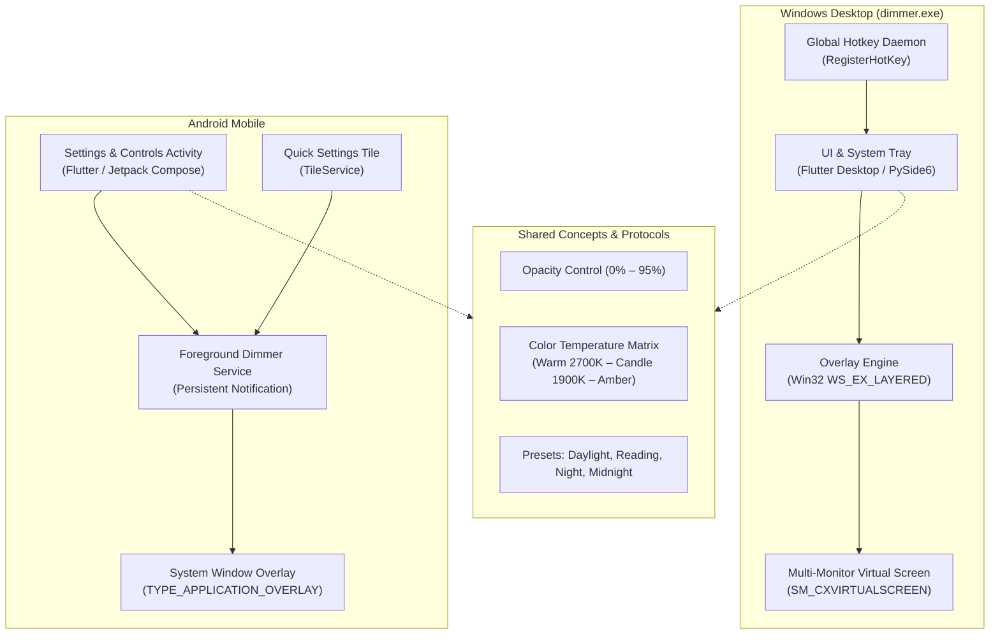

# Dimmer Project: Master Architecture & Development Plan

Comprehensive cross-platform screen dimming utility targeting **Windows (`dimmer.exe`)** and **Android**. Designed to provide deeper-than-hardware brightness reduction, blue-light / night filtering, multi-monitor coverage, and system-level tray and Quick Settings integrations.

---

## 1. System Architecture Overview



---

## 2. Tech Stack Recommendations

| Dimension | Windows Desktop (`dimmer.exe`) | Android Mobile |
| :--- | :--- | :--- |
| **Primary Framework** | **C# / .NET 8 / WPF** | **Flutter Android** |
| **Alternative** | Win32 C++ / Python (PySide6) | Native Android (Kotlin + Compose) |
| **System APIs** | `user32.dll` (`WS_EX_LAYERED`, `WS_EX_TRANSPARENT`), WMI | `WindowManager.LayoutParams.TYPE_APPLICATION_OVERLAY` |
| **Background / Tray** | `NotifyIcon` (System.Windows.Forms) + Win32 Hotkeys | `android.app.Service` (Foreground) + `TileService` |
| **Binary Output** | Standalone single-file `dimmer.exe` | Signed release `.apk` / `.aab` |

---

## 3. Platform Breakdown & Phases

### Windows Platform (`windows/`)
* **Phase 1: Win32 Overlay Foundation**
  * Borderless, always-on-top transparent overlay spanning all virtual displays.
  * Click-through handling (`WS_EX_TRANSPARENT`) so apps beneath remain 100% interactive.
* **Phase 2: Dimming & Color Temperature Engine**
  * Opacity slider (0% to 95% opacity).
  * RGB warm color tinting (reducing blue light emissions).
* **Phase 3: System Tray & Quick Control Popup**
  * Minimize to system tray (notification area).
  * Quick-access popup with slider and preset buttons (Reading, Night, Eclipse).
* **Phase 4: Multi-Monitor & Hotkey Daemon**
  * Global hotkeys (e.g. `Ctrl+Alt+Up` / `Ctrl+Alt+Down`).
  * Per-monitor dimming or unified virtual canvas.
* **Phase 5: Release Engineering**
  * Icon embedding, asset optimization, single executable distribution (`dimmer.exe`).

### Android Platform (`android/`)
* **Phase 1: Overlay Permissions & Core Service**
  * `ACTION_MANAGE_OVERLAY_PERMISSION` intent flow.
  * Foreground Service lifecycle with ongoing status bar notification.
* **Phase 2: Dimmer Surface & Shaders**
  * Transparent full-screen view via `WindowManager`.
  * Touch event pass-through (`FLAG_NOT_TOUCHABLE`, `FLAG_NOT_FOCUSABLE`).
  * Warm tint shader / color filter.
* **Phase 3: Quick Settings Tile & Notification Slider**
  * Quick Settings `TileService` for single-tap on/off toggle.
  * Custom notification view with brightness step buttons.
* **Phase 4: Automation & Scheduling**
  * Sunset-to-sunrise scheduling (or custom start/end time).
  * Screen-off pause to save battery.
* **Phase 5: Performance & Packaging**
  * ProGuard/R8 optimization, battery drain audit, release APK signing.

---

## 4. Structured Conventional Commit Roadmap

```text
# Windows Commits
feat(windows): initialize project structure and runner config
feat(windows): implement Win32 layered transparent overlay window
feat(windows): add click-through support via WS_EX_TRANSPARENT
feat(windows): implement linear opacity dimmer slider (0-95%)
feat(windows): add color temperature filter for warm/blue-light cut
feat(windows): integrate system tray icon and minimize behavior
feat(windows): create quick control tray popup with preset modes
feat(windows): add global hotkeys for brightness adjustment
feat(windows): support multi-monitor virtual screen boundaries
feat(windows): package standalone dimmer.exe with application icon

# Android Commits
feat(android): initialize Android project and manifest configuration
feat(android): add SYSTEM_ALERT_WINDOW permission request flow
feat(android): create foreground dimmer service with persistent notification
feat(android): attach full-screen touch-through overlay via WindowManager
feat(android): implement brightness opacity slider and warm color filter
feat(android): implement Quick Settings TileService for one-tap toggle
feat(android): add interactive notification controls for brightness adjustment
feat(android): implement automated schedule based on time-of-day
feat(android): optimize memory and battery consumption during sleep
feat(android): configure release signing and ProGuard obfuscation rules
```

---

## 5. Next Steps
* Detailed platform specifications are in:
  * **[windows/PLAN.md](file:///C:/Users/Satish%20Patil/Desktop/projects/bitmap/dimmer/temp/windows/PLAN.md)**
  * **[android/PLAN.md](file:///C:/Users/Satish%20Patil/Desktop/projects/bitmap/dimmer/temp/android/PLAN.md)**
* When approved, code implementation can begin directly in the `temp/` folder.
