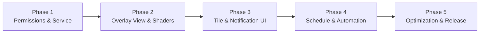

# Dimmer for Android - Engineering Plan

## 1. Executive Summary
A dedicated Android application and persistent background service that provides system-wide screen dimming beyond the hardware minimum brightness, blue light eye protection, Quick Settings tile toggling, and interactive status bar notification controls with zero impact on device battery life.

---

## 2. Technical Stack

* **Core Options:**
  1. **Flutter Android:** Cross-platform shared architecture, method channels for native overlay management.
  2. **Native Android (Kotlin + Jetpack Compose):** Maximum native performance, direct access to Android framework lifecycle, tiny APK size.
* **Key Android Framework APIs:**
  * `android.provider.Settings.ACTION_MANAGE_OVERLAY_PERMISSION`: Guides user to grant "Display over other apps".
  * `WindowManager.LayoutParams.TYPE_APPLICATION_OVERLAY`: Attaches the dimming layer over system UI and apps.
  * Window Flags:
    * `FLAG_NOT_TOUCHABLE`: Mouse and touch events pass straight through to background apps.
    * `FLAG_NOT_FOCUSABLE`: Window never intercepts system key events or soft keyboard.
    * `FLAG_LAYOUT_IN_SCREEN`: Extends overlay across status bar, navigation bar, and display cutouts.
  * `service.TileService`: Instant toggle directly from Android Quick Settings pull-down panel.
  * `NotificationCompat.Builder`: Ongoing notification with quick +/- brightness actions.

---

## 3. Five-Phase Implementation Roadmap



### Phase 1: Permission Flow & Foreground Service Lifecycle
* Check `Settings.canDrawOverlays(context)` on startup.
* Graceful onboarding screen requesting overlay permission.
* Implement `ForegroundService` with notification channel (`IMPORTANCE_LOW` to prevent sound/vibration).
* Handle service restarts via `START_STICKY`.

### Phase 2: Dimmer Surface & Shaders
* Create custom `View` added via `WindowManager.addView()`.
* Configure `WindowManager.LayoutParams` with `FLAG_NOT_TOUCHABLE | FLAG_NOT_FOCUSABLE | FLAG_LAYOUT_IN_SCREEN`.
* Color filter shader:
  * Black alpha tint for pure darkness (0% to 90%).
  * Amber/warm tint matrix for night-time blue light reduction.
* Ensure status bar and navigation bar are properly tinted without glitches.

### Phase 3: Quick Settings Tile & Notification Controls
* Implement `DimmerTileService extends TileService`:
  * Single-tap to toggle dimmer on/off.
  * Dynamic tile state update (`STATE_ACTIVE` vs `STATE_INACTIVE`).
* Custom expanded notification layout with:
  * `[ - ]` and `[ + ]` brightness step buttons.
  * `[ Power ]` toggle button.
  * Current percentage indicator.

### Phase 4: Automation & Sleep Efficiency
* Sunset / Sunrise calculation or custom scheduled timer (e.g., 22:00 to 07:00).
* Screen off (`ACTION_SCREEN_OFF`) listener: pause rendering / detach overlay while display is unlit to eliminate battery consumption.
* Screen on (`ACTION_SCREEN_ON`) listener: instantly restore active dimmer state.

### Phase 5: Production Optimization & Release
* Enable ProGuard / R8 minification and resource shrinking.
* Verify compliance with Google Play Store accessibility & overlay guidelines.
* Build signed release APK and Android App Bundle (`.aab`).

---

## 4. Commit Plan
```text
feat(android): initialize Android project and manifest permissions
feat(android): implement overlay permission request onboarding screen
feat(android): create persistent ForegroundService with status bar notification
feat(android): attach fullscreen touch-through overlay via WindowManager
feat(android): implement opacity dimming shader (0-90% darkness)
feat(android): add warm amber color temperature filter for blue light cut
feat(android): implement Quick Settings TileService for one-tap toggle
feat(android): add interactive notification actions for quick brightness steps
feat(android): implement sunrise/sunset and time-based scheduling
feat(android): add screen-off sleep listener to conserve battery
feat(android): configure R8 minification, ProGuard rules, and release signing
```
